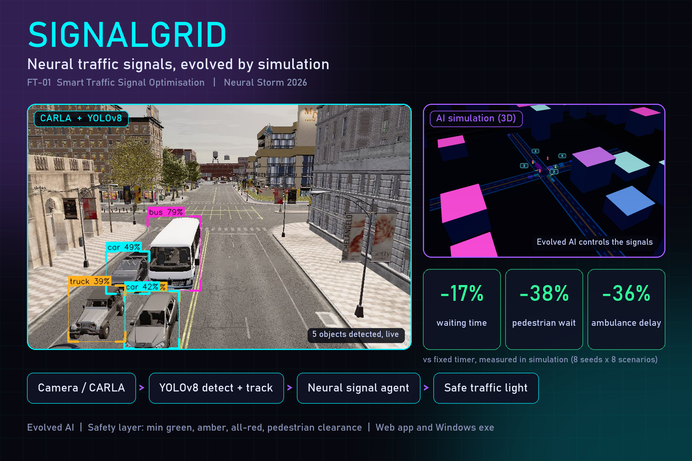
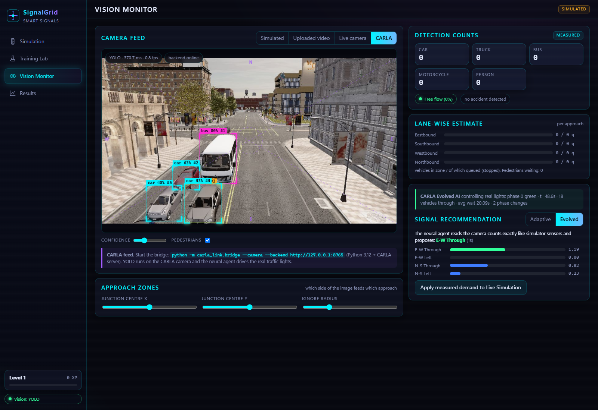
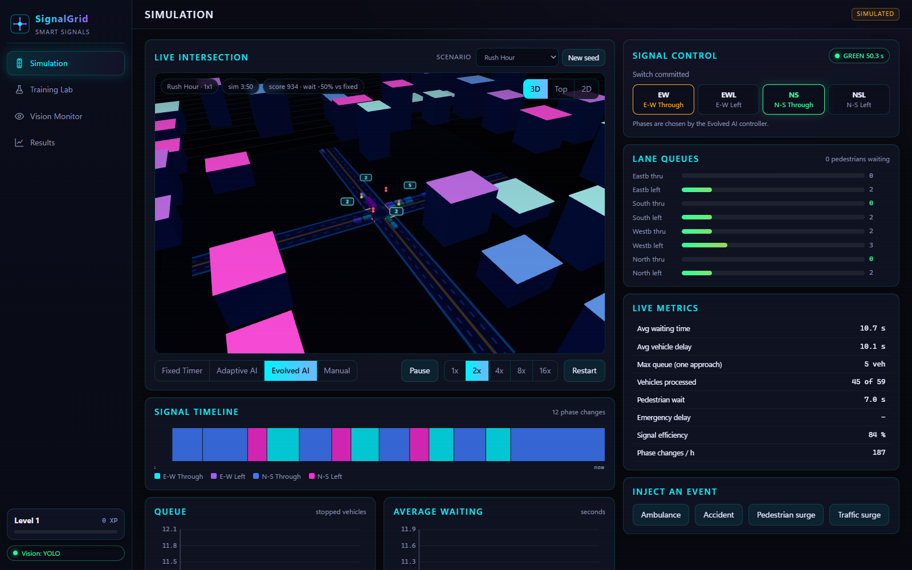
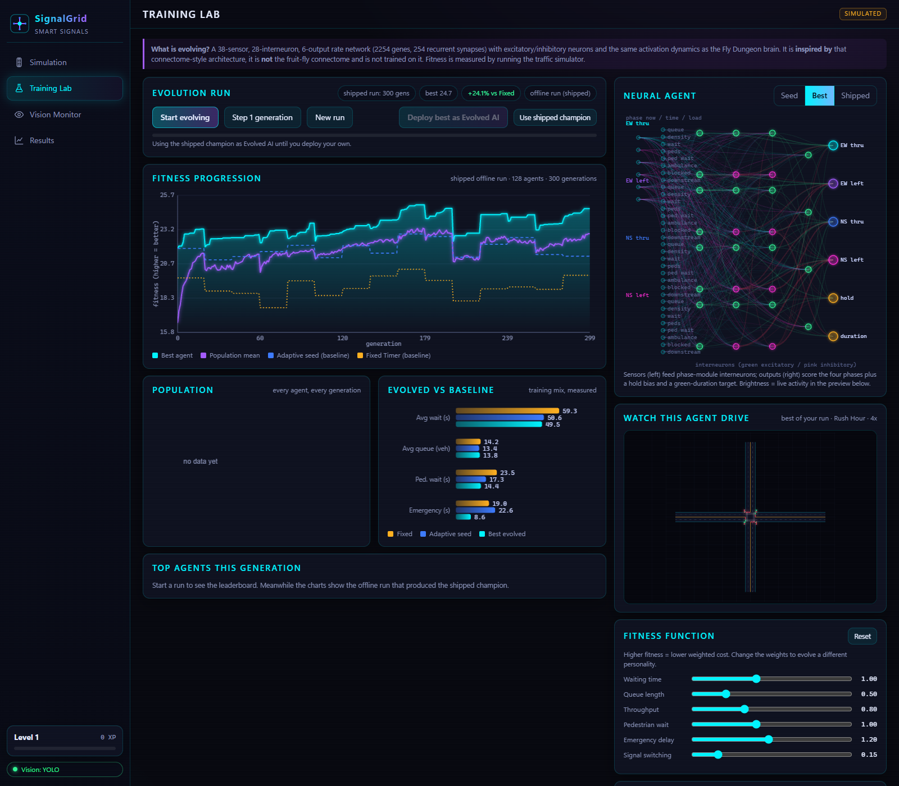
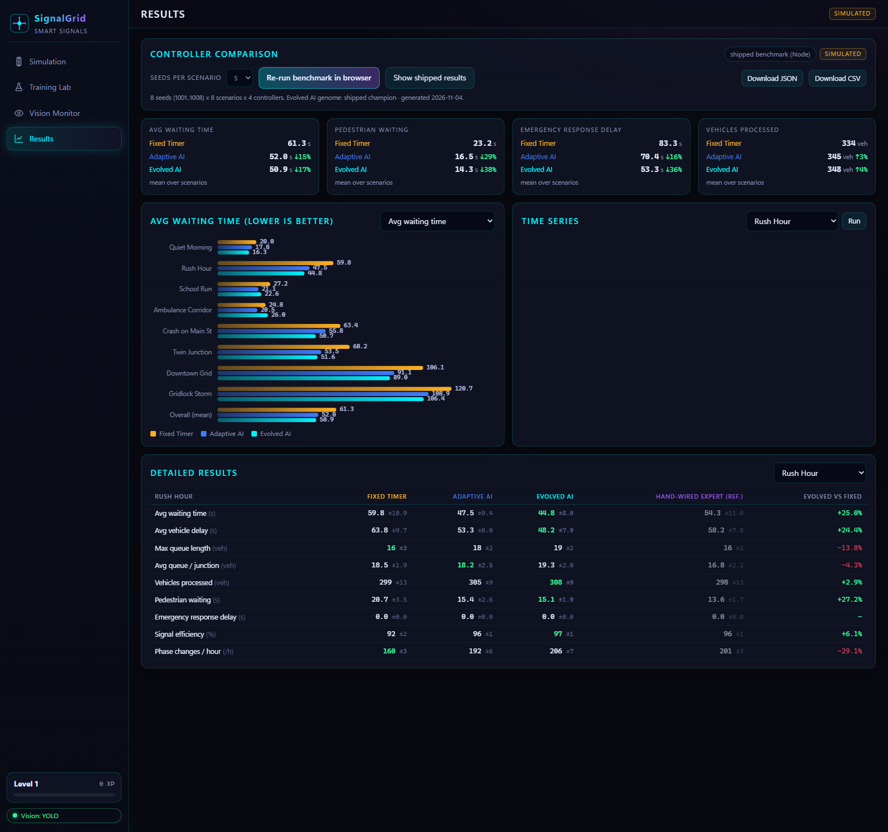
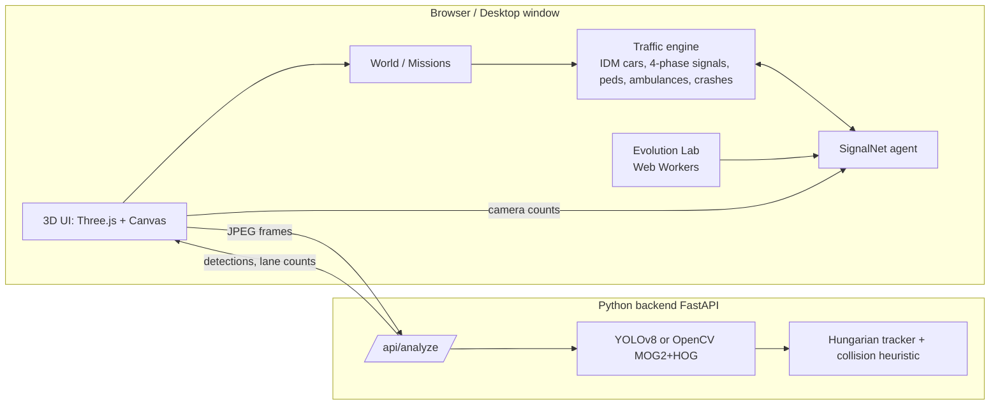

# SignalGrid: neural, evolved, vision-aware traffic signal control

**Neural Storm 2026, Track 1: Future Tech, FT-01 Smart Traffic Signal Optimisation.**

SignalGrid replaces fixed-timer traffic lights with a small recurrent neural agent whose weights were **evolved by neuroevolution** inside a traffic simulator, can be fed by **YOLOv8 computer vision**, and is shown in an interactive **3D city-management game** with measurable, reproducible benchmarks.



| CARLA 3D traffic with YOLOv8 and AI-controlled lights | 3D AI simulation with the signal timeline |
|---|---|
|  |  |
| **Training Lab: real neuroevolution in the browser** | **Results: Fixed vs Adaptive vs Evolved** |
|  |  |

> **Honesty notes.** All performance numbers are measured **inside the SignalGrid simulator**, not on real roads. The agent is *inspired by* the Fly Dungeon connectome-style brain (sparse recurrent rate network, excitatory/inhibitory neurons, evolved genome). It is **not** the fruit-fly connectome and is not trained on it.

## 1. Problem
Most signals run fixed timers: they give the same green to an empty street and a full one, ignore pedestrians until their turn, and treat an ambulance like any car. Result: queues, idle green, long pedestrian waits and slow emergency response.

## 2. Solution
* A **neural signal agent** reads local sensors (queue, density, waiting time, pedestrians, ambulance, blocked lane, downstream spill-back, current phase, congestion) and decides which phase to run, whether to hold, and how long the green should last.
* **Neuroevolution** tunes its 2,254 genes against a fitness function made of waiting time, queue, throughput, pedestrian wait, emergency delay and signal switching.
* A hard **safety layer** wraps every controller (AI, fixed, manual): minimum green, amber, all-red clearance, pedestrian clearance, maximum green and starvation protection. The AI cannot bypass it (checked by `tools/test-invariants.mjs` at every step of 24 runs).
* **Computer vision** (YOLOv8 + tracker, OpenCV fallback) turns video or a live camera into lane counts that feed the same agent.
* A **3D game**: campaign, XP, unlocks, achievements, a live "City score" against a hidden Fixed-Timer twin running identical traffic.

## 3. Architecture

The simulator, agent and evolution are dependency-free ES modules (`web/js/core`) that run identically in the browser and in Node (benchmarks, CI). The frontend is a **static site**; the Python backend is only needed for vision.

## 4. AI / ML approach
`SignalNet` (`web/js/core/controllers.js`): 38 sensors, 28 interneurons organised as four phase modules (4 excitatory + 2 inhibitory neurons each, plus a context neuron), 6 outputs (score for each of 4 phases, hold bias, green-duration target). Dynamics follow Fly Dungeon: `x <- (1-a)x + a*clip(W x + I - theta)`, Dale's-law signs, sparse fixed wiring (254 recurrent synapses). Two seed agents are provided:

* **Adaptive AI** = hand-wired seed that senses only queue and density.
* **Hand-wired expert** (reference only) = same network wired for all eight sensors.
* **Evolved AI** = evolved **from the Adaptive seed**.

## 5. Neuroevolution
Tournament selection (k=3), block crossover, sparse Gaussian mutation with 0.8% random resets, 4 elites, adaptive step size (more success, smaller steps; the Fly Dungeon idea). Fitness is always measured by simulation on the **real scenario presets with jittered load**, rotating every 15-20 generations, with identical scenarios for every individual. The champion is re-validated on held-out scenarios before shipping. Offline run: 300 generations x 128 agents (`tools/evolve.mjs`, ~8 min on 30 threads). You can run the same thing live in the Lab tab (8 Web Workers, about 1 s per generation).

## 6. Computer vision
* **YOLOv8n** (COCO: car, truck, bus, motorcycle, person). Weights shipped in `backend/models/` (from the reference project; AGPL-3.0, Ultralytics).
* Tracker adapted from the reference `video_analyzer.py` (Hungarian assignment, abrupt-stop collision heuristic) with per-second speeds, stopped/queue flags and a stricter crash rule.
* **Fallback** with no PyTorch: MOG2 background subtraction (static camera) + HOG pedestrians.
* Zones turn the image into 4 approaches; counts, queues and waits become the agent's observation; the Vision tab shows the agent's recommended phase and can push the measured demand mix into the simulation.
* Measured on three reference clips: YOLOv8n 14-27 ms/frame on CPU. Inputs: uploaded video and live camera (via the backend) and a simulated sensor.

## 6b. CARLA integration (optional, 3D traffic with real signals)
`carla_link/` connects to a running **CARLA 0.9.16** server (Python 3.12 + the CARLA wheel):
* `bridge.py` picks a 4-way signalised junction (Town10HD), reads vehicles near each stop line (queue, density, waiting time, ambulance), runs the **same evolved network** (`signalnet.py`, verified to match the JavaScript version to 2e-7) and sets the real traffic lights through the same safety layer (min green, amber, all-red, max green). It streams a camera frame and live state to the backend, so **Vision Monitor -> CARLA** shows YOLO detections on the CARLA camera while the AI controls the lights. `--mode both` compares a fixed timer with the AI on the same seed.
* `collect_train.py` follows the reference project's method: CCTV cameras at junctions, exact 3D-to-2D ground-truth boxes (plus a depth check against occlusion), a YOLO dataset, then YOLOv8 fine-tuning.
```powershell
.\scripts
un_carla_demo.ps1                         # CARLA + backend + bridge + browser, one click
.\.venv-carla\Scripts\python -m carla_link.bridge --mode both --seconds 240 --camera --backend http://127.0.0.1:8765
.\.venv-carla\Scripts\python -m carla_link.collect_train --images 600 --epochs 12
```
CARLA traffic-manager traffic is only approximately repeatable between runs, so CARLA numbers are demonstrations, not benchmarks; the benchmark in section 10 comes from the built-in simulator. CARLA is optional: everything else works without it.

## 7. Install and run
Requirements: Python 3.10+ (vision backend), Node 18+ (only for benchmarks), any modern browser.

```powershell
.\scripts\setup.ps1            # venv + OpenCV + YOLOv8   (add -NoYolo for OpenCV only)
.\scripts\run.ps1              # http://127.0.0.1:8765  UI + vision backend
.\scripts\run_web_only.ps1     # static UI only, no Python (vision tab limited to the simulated sensor)
```
**Windows desktop app (.exe):**
```powershell
.\scripts\build_exe.ps1 -Lite  # dist\SignalGrid\SignalGrid.exe, OpenCV detector, small
.\scripts\build_exe.ps1        # full build with YOLOv8 (large, includes PyTorch)
```
The exe starts the backend and opens a native window (pywebview, or Edge/Chrome app mode). Pre-built: see `dist/SignalGrid/` after building.

**Web deployment.** `web/` is a static site (Netlify config included: publish dir `web`). A hosted frontend can talk to a locally running `python -m backend` (CORS and Private-Network headers are enabled). To host the backend separately: `python -m backend --host 0.0.0.0 --port 8765 --no-web` (e.g. on a VM or Render/Fly) and set the URL in `localStorage` key `signalgrid.v1.backendUrl`.

CARLA is optional (see 6b); the built-in simulator needs nothing extra.

## 8. Running simulations and reproducing the benchmark
```bash
node tools/test-invariants.mjs   # safety + physics invariants for every controller
node tools/evolve.mjs 300 128 5  # evolve the champion  -> web/data/evolved.json
node tools/benchmark.mjs 8       # 8 held-out seeds x 8 scenarios -> web/data/benchmarks.json
node tools/calibrate.mjs         # which seeds make each campaign mission winnable
python tools/test_vision.py video.mp4 --backend yolo
```
The Analytics tab re-runs the benchmark in your browser.

## 9. Evaluation methodology
Eight scenarios (quiet, rush hour, school run, ambulance corridor, crash, 2x2 grid, 3x3 grid, storm). For every scenario and seed, **all controllers get byte-identical demand** (arrivals, routes, pedestrians, ambulances, crash). Benchmark seeds 1001-1008 are never used in training. Metrics: average waiting time (stopped time per vehicle, including queued-outside), vehicle delay vs free-flow, max and mean queue, vehicles processed, pedestrian waiting, emergency response delay, signal efficiency (share of green actually used), phase changes per hour.

## 10. Results (simulated, 8 seeds x 8 scenarios, mean of scenario means)
| Metric | Fixed Timer | Adaptive AI | Evolved AI |
|---|---|---|---|
| Avg waiting time (s) | 61.3 | 52.0 (-15%) | **50.9 (-17%)** |
| Avg vehicle delay (s) | 70.6 | 62.0 (-12%) | **59.4 (-16%)** |
| Vehicles processed | 334 | 345 (+3%) | **348 (+4%)** |
| Pedestrian waiting (s) | 23.2 | 16.5 (-29%) | **14.3 (-38%)** |
| Emergency response delay (s) | 83.3 | 70.4 (-15%) | **53.3 (-36%)** |
| Signal efficiency | 89% | 92% | **95%** |
| Avg queue / junction | 12.9 | **12.2** | 12.8 |
| Max queue on one approach | **14** | 15 | 15 |
| Phase changes / hour | **157** | 169 | 199 |

Per-scenario tables are in the Analytics tab and `web/data/benchmarks.json`. **Where the AI does worse:** it does not reduce queue length (it serves busy approaches, letting light ones grow), it switches phases 27% more than the fixed timer, and in the Ambulance scenario the Evolved agent trades vehicle waiting time (26.0 s vs 20.5 s Adaptive) for faster ambulances (12.1 s vs 22.6 s).

## 11. Game layer
The simulation tab scores you live against a hidden Fixed-Timer city fed identical traffic (500 = parity), and lets you switch between Fixed, Adaptive, Evolved and Manual control, or inject an ambulance, a crash or a pedestrian surge. Achievements unlock from measured results (`web/js/ui/achievements.js`).

## 12. Project structure
```
carla_link/          CARLA bridge (AI controls real lights) and dataset/training script
web/                 static frontend (index.html, css, js/core = engine, js/ui = views, vendor/three, data/)
backend/             FastAPI vision service (vision.py, tracker.py, app.py, models/)
desktop/             Windows exe launcher
tools/               evolve, benchmark, calibrate, invariants test, vision test
scripts/             setup / run / build_exe PowerShell scripts
docs/screenshots/
```

## 13. Limitations and future work
* Results are simulated; real traffic has more variety than the engine (no lane changes, one left/through lane pair per approach, right turns do not yield to pedestrians).
* The agent is a local controller; the grid result comes from per-junction control plus spill-back sensing, with no explicit green-wave optimisation. A multi-agent or graph model is the obvious next step.
* Evolution gains over the hand-wired seed are modest (about 2-3 points of waiting time) and concentrated in pedestrian and emergency handling; the hand-wired expert reaches similar numbers, so the value of evolution here is *discovering* that wiring automatically.
* Vision: YOLOv8n is COCO-trained (no ambulance class; emergency detection is simulation-only). A single oblique camera cannot separate turn lanes (an 85/15 split is assumed). The accident heuristic (abrupt stop plus overlap) can false-alarm in dense, slow traffic; the optional trained accident classifier from the reference project can be enabled with `SIGNALGRID_ACCIDENT_MODEL`. The OpenCV fallback needs a static camera.
* Browser rendering is paused by some embedded browsers when the window is hidden; use a normal browser tab.

## Credits
Fly Dungeon (neuroevolution and rate-network ideas), Traffic & Vehicle Monitoring System (YOLO pipeline, tracker, collision heuristic, cyberpunk UI), Three.js (MIT), Ultralytics YOLOv8 (AGPL-3.0).
